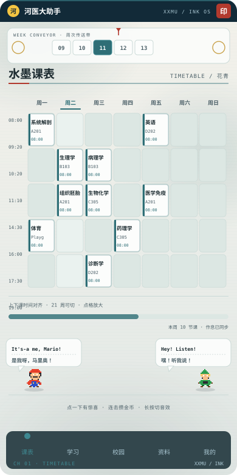
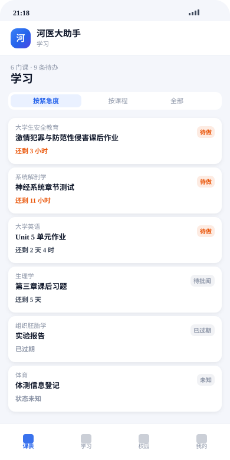
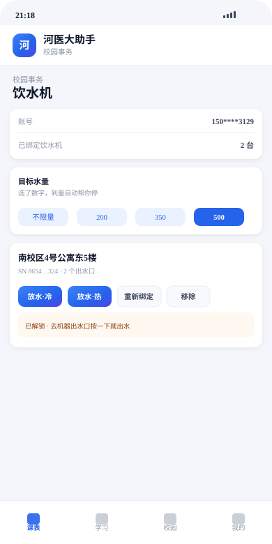

<div align="center">


# 河医大助手 / XXMU Helper

**河南医药大学 · 学生自建的校园教务辅助工具**
**A student-built campus course assistant for Henan Medical University**

课表 · 作业倒计时 · 空教室 · 饮水机 · 校园资料
Timetable · Assignment countdown · Free classrooms · Water dispenser · Campus info

[](#)
[](https://github.com/cyanheee/xxmu-helper/releases)
[](LICENSE)
[](https://wpa.qq.com/msgrd?v=3&uin=572833261&site=qq&menu=yes)

**[简体中文](#简体中文) · [English](#english)**

<br>





<sub>界面示意图（按 App 真实结构绘制，非真机截图）</sub>

</div>

---

<div align="center">

## 简体中文

</div>

### 这是什么

一个安卓 App，解决四件每天都要重复的小事：

- 想知道**本周上什么课**，得登教务、找入口、等页面加载
- 想知道**哪份作业快到期**，得挨个课程点进去翻
- 想知道**现在哪间教室空着**，得手动比对课表
- 想**接杯水**，得先扫码再在机器上按

这几个动作本身不难，但一天要做好几次。这个 App 把它们合到一处。

**它不是学校的官方产品**，是在校学生自己写了自己用的工具。数据全部来自学校官方系统，一切正式事务（成绩、选课、评教、缴费）请以官方系统为准。

### 下载

| 方式 | 地址 |
|---|---|
| 官网 | <https://www.xxmuhelper.top> |
| GitHub Release | [最新版本](https://github.com/cyanheee/xxmu-helper/releases) |
| 直连下载 | <https://xxmu-auth.pages.dev/v1/apk> |
| 更新群 | QQ `1097668324` |

> 在微信里打开会提示无法下载安装包，这是微信的限制。点右上角「···」→「在浏览器打开」，再点一次下载即可。

### 联系我

用的人多了我才知道该继续做什么。有问题、想提需求、发现 bug，都可以直接找我。

| 渠道 | 联系方式 |
|---|---|
| QQ | **572833261** |
| QQ 群（更新通知） | [1097668324](https://qm.qq.com/q/xxmuhelper) |
| 邮箱 | 572833261@qq.com |
| GitHub | [github.com/cyanheee](https://github.com/cyanheee) |

### 功能

**课表**

登录教务后自动读取，按周渲染成网格。当前周高亮，今天所在列加标记，每门课显示教室与起止时间。

顶部有一条状态说明栏，用来区分四种情况：**尚未同步 / 本周确实没课 / 周次读不懂 / 读取失败**。这四种在屏幕上必须能分开——否则用户看到的都是「一张空白表格」，没法判断是自己没同步还是软件坏了。

**作业与考试**

从学习通读取作业和考试，按紧急程度排序。

状态处理是这里最要紧的部分：平台返回的状态文案有很多种写法，能识别的归类为「待做 / 待批阅 / 已完成 / 已过期」，**认不出来的一律标成「未知」，绝不判成「已完成」**。因为判成已完成会让你错过截止且不可恢复，判成未知最多让你多点开看一次，代价可逆。

**空教室**

按你课表里出现过的教室，算出某天某几节哪间空着。也可以反过来找「整周都空」的自习位置。

**局限要说清**：只能看到你自己课表里出现过的教室（一般十几间），看不到别的班的安排，所以结果仅供参考。

**饮水机**

扫一次码记住机器，之后在手机上操作。

这里有个容易误解的地方：**手机只能「解锁」，出水还得在机器出水口按一下物理键**。胖乖生活平台的官方页面原文就是「请在出水口处点按开始接水」——它没有开放远程开阀的接口，这是硬件设计，不是没做。

但「停」是可以远程下发的，所以做了**定量放水**：选了目标水量之后，到量自动帮你发停止命令。三条限制写在界面上：到量到停阀有几秒延迟会多流一点；断网盯不住；一直没检测到出水会提醒你去按。

**校园资料**

学校常用入口、办事流程、联系方式归到一处，支持检索和本地新增。

### 隐私

这是最需要说清楚的部分。

| 数据 | 存在哪 | 会不会上传 |
|---|---|---|
| 教务 / 学习通密码 | **不存储** | 直接提交给学校官方登录页 |
| 登录会话 Cookie | 手机本地 WebView | 不上传 |
| 课表、作业 | 手机本地 | 不上传 |
| 设备标识 | 本地生成的随机串哈希 | 只用于区分设备，不采集 IMEI/MAC |

服务端（Cloudflare Workers）只保存三样东西：**版本号、公告、设备数量**。不保存课表，不保存作业，不保存密码。

### 常见问题

<details>
<summary><b>课表是空的 / 少了几节课</b></summary>

先确认教务能正常登录，然后在课表页点「重新同步」。

如果还是空，课表页顶部的说明条会告诉你属于哪种情况。点条上的「复制课表诊断」，把内容发到群里，能直接定位问题。
</details>

<details>
<summary><b>会不会要我的教务密码</b></summary>

不会。登录是在 App 内置浏览器里打开的**学校官方登录页**，密码输给的是学校，App 只保留登录后的会话凭证。密码不经过开发者服务器。
</details>

<details>
<summary><b>饮水机为什么点完还要在机器上按一下</b></summary>

胖乖生活平台只开放了「解锁」接口，没有远程开阀能力。手机能做的到解锁为止，出水必须人在机器上按。但「停」可以远程做，所以设了目标水量之后能自动停。
</details>

<details>
<summary><b>提示「版本过低」进不去</b></summary>

这个提示只在旧版本确实有问题时出现。按页面按钮下载新版覆盖安装即可，数据不会丢。
</details>

<details>
<summary><b>换了手机 / 重装了</b></summary>

重装、填学号、重新登录教务，课表会自动同步回来。一个学号可绑几台设备，超限时联系群里的管理员清一下记录。
</details>

<details>
<summary><b>这是官方的吗</b></summary>

不是。学生自建工具，和学校、和超星都没有隶属关系。
</details>

### 技术

- **界面**：纯静态 HTML/CSS/JS，跑在系统 WebView 里，不依赖任何前端框架
- **原生壳**：Java，`aapt2 + javac + d8 + apksigner` 手工打包，不用 Gradle
- **服务端**：Cloudflare Worker + KV，只做版本与公告这类轻量状态
- **数据抓取**：Python，电脑端跑

架构上有一条硬约束：**任何从 JS 调到 Java 的桥方法都不许阻塞**（不许在里面做网络、文件大 IO、图片解码），必须立刻返回、后台干活、完成后回调。因为 WebView 调 Java 时 JS 线程会同步等返回值，一慢整个界面就「能滑动但点什么都卡死」。

### 开发

```bash
# 静态体检（版本号一致性 / 资源同步 / 关键符号）
node tools/check_web.js

# 离线测试（课表解析、作业状态、饮水机协议、授权状态机…）
node tools/test_parsekb.js
node tools/test_hwstatus.js
node tools/test_water.js

# 打包
python tools/build_apk.py
```

所有离线测试都能在无网络、无真机的环境下重复执行。

### 授权

代码以 **AGPL-3.0** 发布。简单说：

- ✅ 可以看、可以学、可以改、可以自己部署
- ✅ 改完自己用、给同学用都没问题
- ⚠️ **如果改成网络服务提供给他人使用，必须同样开源**
- ⚠️ 保留原作者署名

之所以选 AGPL 而不是 MIT：这个项目的代码是公开的，但不希望有人拿去做闭源的商业产品。

### 声明

- 与河南医药大学、超星学习通、胖乖生活均无隶属或合作关系
- 所有数据以学校官方系统为准
- 项目按「现状」提供，不对使用后果作任何担保
- 如果你是学校方面的工作人员且对这个项目有异议，请通过群或邮箱联系，我会配合处理

---

<div align="center">

## English

</div>

### What this is

An Android app that folds four small, repetitive daily chores into one place:

- Want to know **what classes you have this week**? Log into the academic system, find the right page, wait for it to load.
- Want to know **which assignment is due soon**? Click into each course one by one.
- Want to know **which classroom is empty right now**? Compare against your timetable by hand.
- Want **a cup of water**? Scan a QR code, then press a button on the machine.

None of these is hard on its own, but you do them several times a day. This app puts them together.

**This is not an official school product.** It is a tool written and used by a student. All data comes from official school systems; anything formal — grades, course registration, teaching evaluations, payments — should be handled on the official systems.

### Download

| Channel | Address |
|---|---|
| Website | <https://www.xxmuhelper.top> |
| GitHub Release | [Latest release](https://github.com/cyanheee/xxmu-helper/releases) |
| Direct APK | <https://xxmu-auth.pages.dev/v1/apk> |
| Update group | QQ `1097668324` |

> Opening the page inside WeChat will refuse to download the APK — that is WeChat's own restriction. Tap "···" in the top-right corner → "Open in browser", then tap download again.

### Contact

The more people use it, the clearer it is what to build next. Bug reports, feature requests and questions are all welcome.

| Channel | Contact |
|---|---|
| QQ | **572833261** |
| QQ group (release updates) | [1097668324](https://qm.qq.com/q/xxmuhelper) |
| Email | 572833261@qq.com |
| GitHub | [github.com/cyanheee](https://github.com/cyanheee) |

### Features

**Timetable**

Read automatically after logging into the academic system, then rendered as a weekly grid. The current week is highlighted, today's column is marked, and every course shows its classroom and start/end time.

A status bar at the top distinguishes four situations: **not synced yet / genuinely no classes this week / week numbering could not be parsed / read failed**. These four must look different on screen — otherwise all the user sees is "a blank table" and cannot tell whether they forgot to sync or the app is broken.

**Assignments and exams**

Read from the online learning platform and sorted by urgency.

Status handling is the most important part here: the platform returns many different phrasings for a status, so anything recognisable is grouped into "to do / awaiting grading / done / expired", and **anything unrecognised is marked "unknown" — never "done"**. Marking an unknown as "done" makes you miss a deadline irreversibly; marking it "unknown" costs you one extra tap. The cost is reversible.

**Free classrooms**

Uses the set of classrooms that appear in *your* timetable to work out which rooms are free on a given day and period. It can also find "free all week" study spots.

**The limitation is stated clearly**: it only sees classrooms from your own timetable (usually a dozen or so), not other classes' schedules, so the result is a reference only.

**Water dispenser**

Scan the machine's QR code once to remember it, then operate from the phone.

There is a commonly misunderstood point here: **the phone can only "unlock"; water actually starts when someone presses the physical button on the dispenser.** The official platform page literally says "please tap at the outlet to start". It exposes no remote valve-opening API — that is a hardware design decision, not an unfinished feature.

However, *stopping* can be issued remotely, so the app implements **measured dispensing**: pick a target volume and it sends the stop command for you once reached. Three limits are written into the UI: a few seconds of lag between target and valve closure means a little extra water; a network drop means it stops tracking; and if no water is detected at all, it reminds you to press the button.

**Campus info**

Common school entry points, procedures and contacts gathered in one place, with search and locally added entries.

### Privacy

This is the part that deserves the clearest statement.

| Data | Where it lives | Uploaded? |
|---|---|---|
| Academic / learning-platform password | **Never stored** | Submitted directly to the school's official login page |
| Session cookies | Local WebView | No |
| Timetable, assignments | Local device | No |
| Device identifier | Locally generated random hash | Only to tell devices apart; no IMEI/MAC collection |

The backend (Cloudflare Workers) stores exactly three things: **version number, announcements, device count**. No timetables, no assignments, no passwords.

### FAQ

<details>
<summary><b>The timetable is empty / missing some classes</b></summary>

First confirm you can log into the academic system, then tap "Re-sync" on the timetable page.

If it is still empty, the status bar at the top of the page tells you which case applies. Tap "Copy timetable diagnostics" and send the content to the group — it pinpoints the problem directly.
</details>

<details>
<summary><b>Does it want my academic-system password?</b></summary>

No. Login happens on the **school's official login page** inside the app's built-in browser. The password goes to the school; the app only keeps the resulting session. The password never passes through the developer's server.
</details>

<details>
<summary><b>Why do I still have to press the machine after using the water dispenser feature?</b></summary>

The platform only exposes an "unlock" API, with no remote valve control. The phone's capability ends at unlocking; starting the water requires pressing the button on the machine. Stopping *can* be done remotely, which is why setting a target volume lets it stop automatically.
</details>

<details>
<summary><b>It says "version too old" and won't let me in</b></summary>

That message only appears when an old version genuinely has a problem. Download the new version from the button shown and install over it — your data is kept.
</details>

<details>
<summary><b>I changed phones / reinstalled</b></summary>

Reinstall, enter your student ID, log into the academic system again, and the timetable syncs back. One student ID can bind a few devices; if you hit the limit, ask an admin in the group to clear the records.
</details>

<details>
<summary><b>Is this official?</b></summary>

No. It is a student-built tool with no affiliation to the university or to Chaoxing.
</details>

### Technical notes

- **UI**: plain static HTML/CSS/JS running in the system WebView, no frontend framework
- **Native shell**: Java, packaged by hand with `aapt2 + javac + d8 + apksigner`, no Gradle
- **Backend**: Cloudflare Worker + KV, holding only lightweight state such as version and announcements
- **Data scraping**: Python, run on a desktop

One hard architectural constraint: **every JS-to-Java bridge method must be non-blocking** — no network, no large file IO, no bitmap decoding inside it. It must return immediately, do the work on a background thread, and call back when finished. The reason: when WebView calls Java, the JS thread waits synchronously for the return value, so one slow call freezes the whole UI into "scrolls fine but nothing responds".

### Development

```bash
# Static checks (version consistency / asset sync / key symbols)
node tools/check_web.js

# Offline tests (timetable parsing, assignment status, dispenser protocol, licence state machine…)
node tools/test_parsekb.js
node tools/test_hwstatus.js
node tools/test_water.js

# Build
python tools/build_apk.py
```

Every offline test can be re-run without a network connection and without a physical device.

### Licence

Released under **AGPL-3.0**. In plain terms:

- ✅ Read it, learn from it, modify it, deploy it yourself
- ✅ Use your modified version for yourself or your classmates
- ⚠️ **If you turn it into a network service for others, you must open-source your version too**
- ⚠️ Keep the original author's attribution

AGPL rather than MIT because: the code is public, but it should not become someone's closed-source commercial product.

### Disclaimer

- Not affiliated with Henan Medical University, Chaoxing Learning, or the Qiekj water-dispenser platform
- All data is subject to the official school systems
- Provided "as is", with no warranty of any kind
- If you are a staff member of the university and have concerns about this project, please reach out via the group or email and I will cooperate

---

<div align="center">

**课表、作业、空教室，一个 App 就够了。**
**Timetable, assignments, free classrooms — one app is enough.**

</div>
